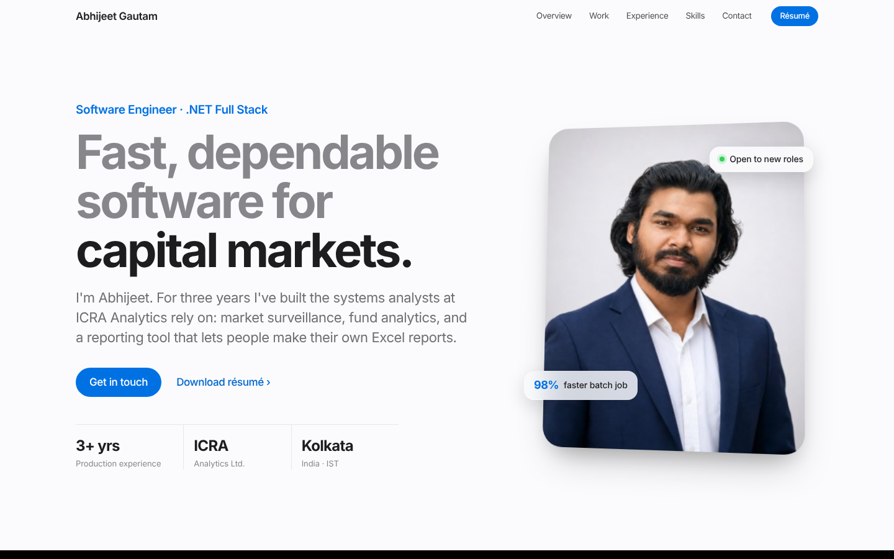
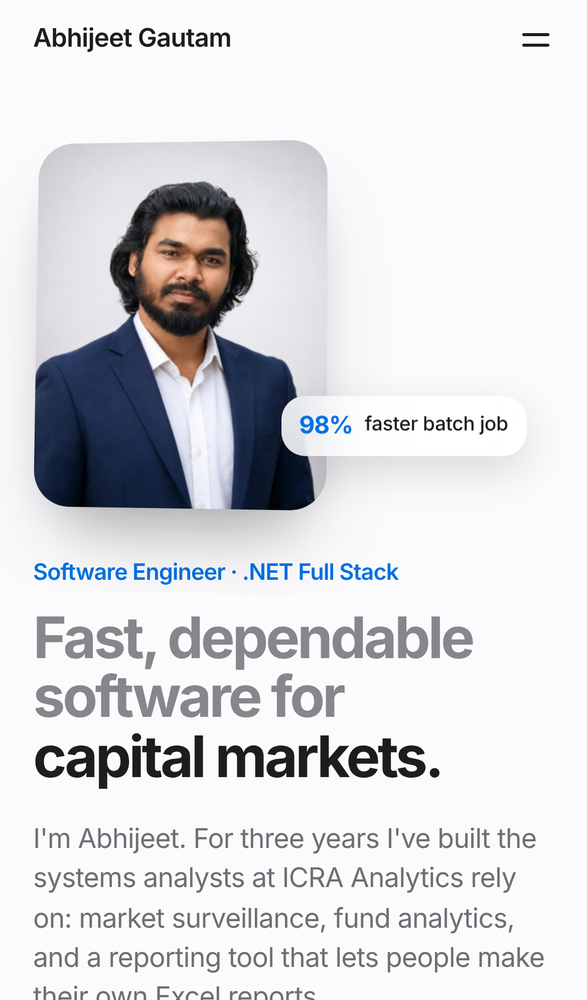
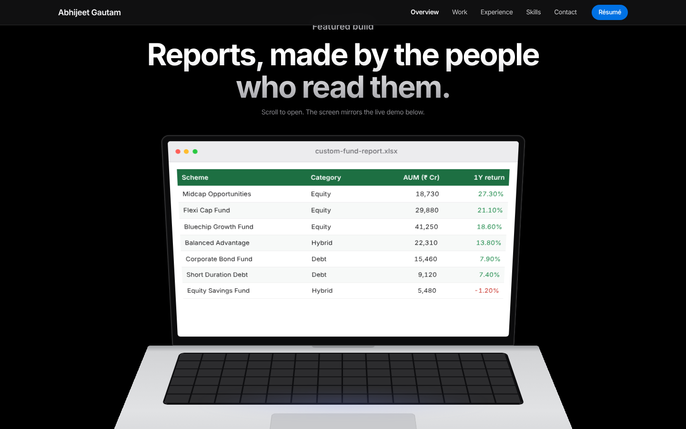
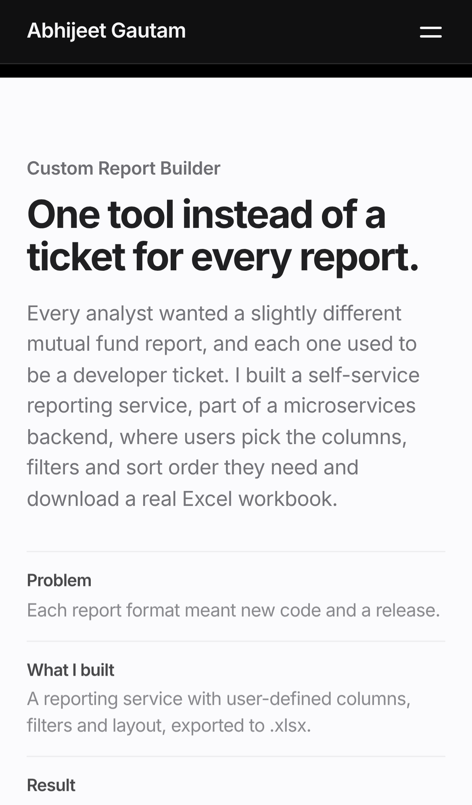

# Abhijeet Gautam — portfolio

Live: **https://herijeet.github.io/AbhijeetGautam/**

Static, hand-built site: `index.html`, `styles.css`, `main.js`. No build step, no frameworks and no web fonts
(it uses the system font: SF Pro on Apple devices, Segoe UI on Windows, Roboto on Android).

Run it locally:

```bash
python3 -m http.server 8000
```

## What's on the page

- A light, Apple-style layout with automatic dark mode, which follows the visitor's system setting.
- A **scroll-driven 3D laptop** built in pure CSS: the lid opens as you scroll, and its screen mirrors the live demo.
- A working **custom report builder** demo (made-up fund data). Pick columns, filter and sort, then export a CSV that opens in Excel.
- Case-study tiles with small live visuals: batch-job race chart, portfolio overlap, database switcher, microservices map, upload and CI/CD pipeline.
- About, experience, education and a "tech specs" skills list.

## Responsive and accessible

- Layout breakpoints at 480, 734, 900, 1068 and 1440 px, tested on phone (390 px), tablet (810 px), laptop (1366 px) and monitor (1920 px) with no horizontal scrolling.
- Mobile menu, 44 px touch targets, safe-area insets for notched phones, and `svh` units so mobile browser bars don't break the pinned section.
- Every animation respects `prefers-reduced-motion`.

## Screenshots

`.github/screenshots/`

| Desktop | Phone |
| --- | --- |
|  |  |
|  |  |
